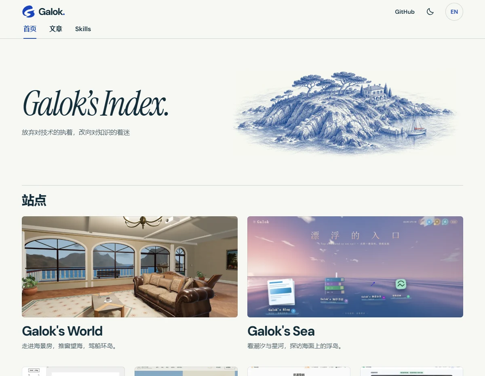
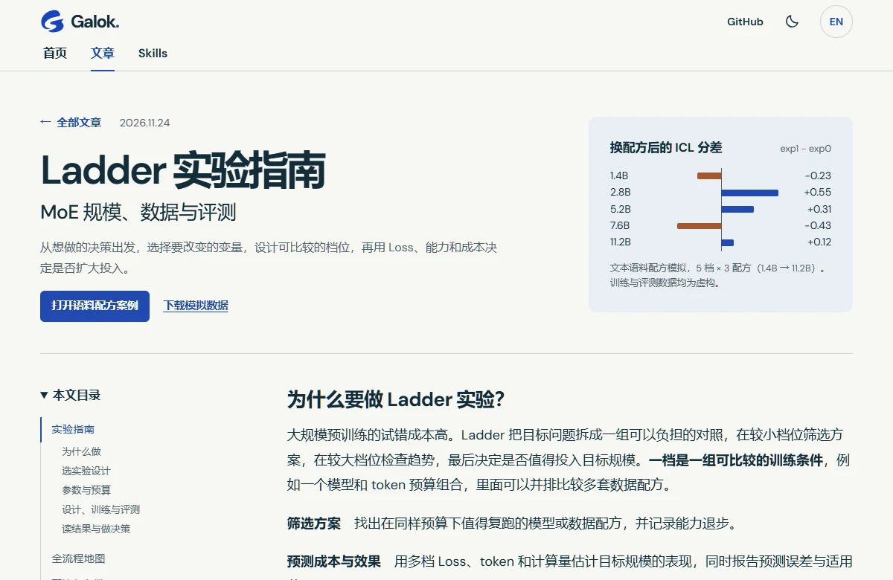
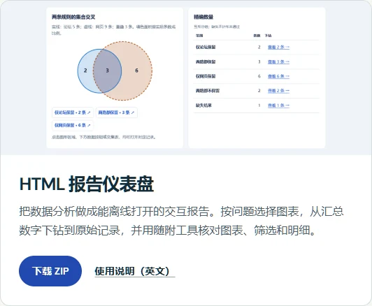

<a href="https://galok.cn/"></a>

# Galok's Index

> 放弃对技术的执着，改向对知识的着迷

Galok's Index 是 Galok 的个人主页。这里收录我做的网站、写下的文章、日常使用的 Skills 和开源项目。首页用真实页面截图做预览，点进卡片就能访问对应项目。你可以在海景房里漫游，读一篇训练实验笔记，也可以带走一套做离线报告的工具。

[访问首页](https://galok.cn/) · [阅读文章](https://galok.cn/articles/) · [浏览个人 Skills](https://galok.cn/skills/) · [查看引用 Skills](https://galok.cn/skills/referenced/) · [浏览开源项目](https://galok.cn/open-source/)

[](https://galok.cn/)

首页的两滴蓝色染料在水面上交锋，最后印在亚麻布上，洇成 Galok 的标志。网页用 HTML `picture` 静音循环播放第十二版，加载时先显示轻量水面图。手机和平板（视口 ≤ 900 px）使用 768 px、30 fps 的动画 AVIF；桌面按像素密度选择 960 或 1280 px、60 fps 的版本。另有动画 WebP 用于兼容。启用「减少动态效果」时直接显示布面定帧，也可以用图上的「静态图」切换。

[网页动画素材](home/ink/) · [第十二版有声原片（1080p / 60 fps，13 秒）](_masters/galok-ink-v12.mp4)

## 从哪里开始

| 入口 | 可以做什么 |
| --- | --- |
| [Galok's World](https://galok.cn/world/) | 以第一人称走进海景房，推窗看海，也可以出门驾船环岛。 |
| [Galok's Sea](https://galok.cn/sea/) | 在海上浮岛之间探索，看海水、昼夜、雷雨与星河变化。 |
| [文章](https://galok.cn/articles/) | 按日期阅读技术笔记。长文带章节目录，交互指南可在正文里查看图表、调整参数和下载案例数据。 |
| [Skills](https://galok.cn/skills/) | 在个人库下载可复用的 Skill 及配套文件，点「使用说明」查看用法。引用库另列收录工具及其来源。 |
| [开源](https://galok.cn/open-source/) | 从实景预览认识断层回声、LoveShare 和轻块桌面，进入源码仓库、部署指南、试玩或下载。 |

首页、文章、Skills 和开源项目共用中英文导航与深浅主题，支持手机、平板和桌面阅读。文章正文保留原稿语言。

| [Ladder 实验指南](https://galok.cn/articles/ladder-experiments/) | [HTML 报告仪表盘](https://galok.cn/skills/html-report-dashboard.zip) |
| --- | --- |
| [](https://galok.cn/articles/ladder-experiments/) | [](https://galok.cn/skills/) |

## 给站点添加内容

仓库中的维护 Skills 放在 `.agents/skills/`。在这个仓库里使用 Agent 时，可以直接提供网址、文档或压缩包，并点名对应的 Skill。

| 要做的事 | 调用示例 | 维护位置 |
| --- | --- | --- |
| 首页添加站点 | 「用 `$add-index-site` 把这个网址加到首页，并制作预览。」 | `index.html` 中的站点卡和 `home/previews/`。[站点上架流程](.agents/skills/add-index-site/SKILL.md) |
| 个人库添加或更新 Skill | 「用 `$add-personal-skill` 上架这个 ZIP，附中英文简介和使用说明。」 | `skills/catalog.json`、下载包、封面和 `skills/_sources/`。[个人 Skill 上架流程](.agents/skills/add-personal-skill/SKILL.md) |
| 发布完整 HTML 文章 | 「用 `$import-html-article` 完整迁入这份报告，核对全文、图表和交互。」 | `_posts/` 和文章专属资源。[HTML 文章迁移流程](.agents/skills/import-html-article/SKILL.md) |
| 维护引用 Skill | 「用 `$maintain-galok-content` 收录这个上游 Skill，并标注来源。」 | [站点维护说明](.agents/skills/maintain-galok-content/SKILL.md)与[下载清单字段](skills/README.md) |
| 收录开源项目 | 「用 `$maintain-galok-content` 把这个仓库添加到开源页。」 | [项目清单](_data/open_source.yml)和[新增示例](#添加开源项目) |

### 添加开源项目

在 [`_data/open_source.yml`](_data/open_source.yml) 末尾追加一项。页面按清单顺序显示，最小条目只需项目名、双语简介和仓库地址。中英文项目名相同时可以省略 `name_en`。

```yaml
- name: 示例工具
  name_en: Example Tool
  description: 把一份书签导出为可搜索的网页。
  description_en: Export bookmarks as a searchable web page.
  repository: https://github.com/OWNER/REPO
```

需要预览时，将项目实景截图放进 [`open-source/previews/`](open-source/previews/)，在同一条目下加上以下可选字段。两行分类、技术栈、图片和操作入口都可以独立省略。用了其他项目的图片时，在[预览素材说明](open-source/previews/NOTICE.txt)记录来源和授权。

```yaml
  category: 书签工具
  category_en: Bookmark tool
  preview: example-tool.webp
  stack: [TypeScript, SQLite]
  action:
    url: https://github.com/OWNER/REPO/releases
    label: 下载应用
    label_en: Download app
```

将想重点展示的项目移到清单首位并设为 `featured: true`，它会在宽屏占据整行。提交前在本地打开 `/open-source/`，切到英文，点一次源码和操作入口。

### 发布 Markdown 文章

在 `_posts/` 新建 `YYYY-MM-DD-short-title.md`。文件名末段会成为稳定地址 `/articles/short-title/`。

```markdown
---
title: "文章标题"
description: "一两句介绍文章内容。"
---

正文从这里开始。

## 第一节

这里可以使用列表、表格、链接和围栏代码块。
```

英文界面的标题和摘要用 `title_en`、`description_en`。英文正文可加 `language: en`。需要列表封面时，把图片放在 `articles/`，在文件头填写 `cover: /articles/文件名.webp`。发布后 Jekyll 会更新正文页、文章列表、首页最近三篇和站点地图，两节及以上的普通文章会从二级标题生成目录。

## 本地预览与部署

项目使用 Jekyll、原生 HTML/CSS/JavaScript 和 GitHub Pages。安装 Ruby 和 Bundler 后，在仓库根目录运行：

```sh
bundle install
bundle exec jekyll serve
```

打开 [本地预览](http://localhost:4000/)。共用导航在 `_layouts/index-shell.html`，文章模板在 `_layouts/reading.html`。推送到 `main` 后，GitHub Pages 从仓库根目录构建并发布到 [galok.cn](https://galok.cn/)。

海景房源码在 `villa/`，生成的静态文件在 `world/`。修改住宅后，在 `villa/` 运行 `npm ci`、`npm run build:pages`，并提交源码与构建产物。[住宅开发说明](villa/README.md) · [海上浮岛开发说明](sea/README.md)
