<section id="panel-guide" data-panel="guide" aria-labelledby="tab-guide" markdown="1">

<nav aria-label="实验指南目录" class="guide-jumps">
<a href="#guide-purpose">为什么做</a>
<a href="#guide-pick">选实验设计</a>
<a href="#guide-measure">参数与预算</a>
<a href="#guide-run">设计、训练与评测</a>
<a href="#guide-decide">读结果与做决策</a>
</nav>

<section id="guide-purpose" markdown="1">

## 为什么要做 Ladder 实验？

大规模预训练的试错成本高。Ladder 把目标问题拆成一组可以负担的对照，在较小档位筛选方案，在较大档位检查趋势，最后决定是否值得投入目标规模。**一档是一组可比较的训练条件**，例如一个模型和 token 预算组合，里面可以并排比较多套数据配方。

**筛选方案**　找出在同样预算下值得复跑的模型或数据配方，并记录能力退步。

**预测成本与效果**　用多档 Loss、token 和计算量估计目标规模的表现，同时报告预测误差与适用范围。

**支持下一次投入**　根据目标指标、显存及时间预算，决定上大档验证、补关键对照，还是停止这一候选。

</section>

<section id="guide-pick" markdown="1">

## 从想回答的问题选实验

切换目标，查看该固定什么、改变什么，以及结果将支持哪种决策。矩阵与数值均为教学示意。

<fieldset>
<legend>我想知道</legend>
<label class="guide-option"><input checked="" name="guide-goal" type="radio" value="scale"/>目标规模的 Loss 和 token 预算</label>
<label class="guide-option"><input name="guide-goal" type="radio" value="sparsity"/>同样激活规模下该放多少专家</label>
<label class="guide-option"><input name="guide-goal" type="radio" value="granularity"/>专家切得更细是否值得</label>
<label class="guide-option"><input name="guide-goal" type="radio" value="data"/>换一套数据配方是否值得</label>
<label class="guide-option"><input name="guide-goal" type="radio" value="optimization"/>某档该用什么学习率和 batch</label>
</fieldset>

<div data-design="scale" markdown="1">

### Scale Ladder · 规模阶梯

用可负担的训练点估计模型放大后会怎样，并判断在给定算力下，预算该用在更大的模型还是更多的 token 上。

**固定什么**　固定数据配方、评测口径和架构族。按严格的规模阶梯定义，保持路由激活比例与单专家大小，记录用哪些架构维度放大。

**改变什么**　改变激活参数量 N_active。在多个规模上分别改变训练 token D。若要比较预算分配，按同 FLOPs 分组。

**评测什么**　统一留出集的验证 Loss、实际训练 token 与 FLOPs，以及较大档的留出预测误差。

**得到什么**　带适用范围和误差的 Loss 预测，以及满足目标预算的模型与 token 候选。

<label class="guide-choice" id="guide-scale-toggle"><input id="guide-diagonal" type="checkbox"/>只沿一条路径放大模型和 token</label>

<div data-matrix="cross" markdown="1">

<div class="table-wrap" markdown="1">

多个激活规模与多个 token 预算交叉比较

| N_active / 训练 token | 10B | 20B | 40B |
| --- | --- | --- | --- |
| 0.2B | 训练 | 训练 | 训练 |
| 0.4B | 训练 | 训练 | 训练 |
| 0.8B | 训练 | 训练 | 留出验证 |

</div>

横向比较同一模型训练更多 token 的效果，纵向比较同 token 下放大模型的效果。右下角照常训练，但留到拟合完成后验证。

</div>

<div data-matrix="diagonal" markdown="1">

<div class="table-wrap" markdown="1">

模型与 token 同时变化的三点路径

| N_active / 训练 token | 10B | 20B | 40B |
| --- | --- | --- | --- |
| 0.2B | 训练 | 未覆盖 | 未覆盖 |
| 0.4B | 未覆盖 | 训练 | 未覆盖 |
| 0.8B | 未覆盖 | 未覆盖 | 训练 |

</div>

这条路径能比较三个实际组合。因为没有同规模不同 token 或同 token 不同规模的对照，很难区分两者的贡献。

</div>

</div>

<div data-design="sparsity" markdown="1">

### Sparsity Ladder · 稀疏度阶梯

每个 token 只走少数专家。增加可选专家可能扩大模型容量，也会增加需要存储和调度的专家权重。这个实验用来量化两边的变化。

**固定什么**　固定主干、单专家大小、Top‑K、N_active、训练 token 与配方。对照相同的评测和硬件条件。

**改变什么**　增加路由专家总数。总参数和稀疏比随之上升。记录专家并行设置，核算实际 FLOPs 与硬件成本。

**评测什么**　验证 Loss、目标能力、峰值显存、吞吐、通信占比及专家负载。

**得到什么**　性能增益与资源代价表，找出进一步加专家的收益拐点或硬件成本上限。

对照配置示意

<div class="table-wrap" markdown="1">

| 组别 | 专家总数 | Top‑K | 总数 / Top‑K |
| --- | --- | --- | --- |
| 基线 | 24 | 3 | 8 |
| 更多专家 | 48 | 3 | 16 |
| 继续增加 | 96 | 3 | 32 |

</div>

这个示意里每个 token 仍走 3 个专家。新增专家会扩大可选集合，实际计算和耗时仍要单独测量。

</div>

<div data-design="granularity" markdown="1">

### Granularity Ladder · 粒度阶梯

把相同量的专家参数分成更多、更小的专家。比较路由可以组合更多专家时，收敛或能力能否改善，以及系统开销多大。

**固定什么**　固定主干、共享组件、训练 token 和数据配方，并在相同参数统计口径下匹配 N_active 与 N_total。

**改变什么**　缩小单专家，同时按反比增加总专家数与 Top‑K。按需核对整数维度、参数量和实际 FLOPs。

**评测什么**　同 token 或同 FLOPs 的验证 Loss 曲线、目标能力、路由负载、实际吞吐和通信开销。

**得到什么**　在同等参数预算下，选出值得采用的专家粒度和部署配置。

对照配置示意

<div class="table-wrap" markdown="1">

| 组别 | 单专家相对大小 | 专家总数 | Top‑K |
| --- | --- | --- | --- |
| 基线 | 1 | 24 | 3 |
| 更细 | ½ | 48 | 6 |
| 继续切分 | ¼ | 96 | 12 |

</div>

每一行的「专家总数 × 相对大小」和「Top‑K × 相对大小」都一样。实际训练仍会受到路由和通信开销的影响。

</div>

<div data-design="data" markdown="1">

### 数据配方对照与消融

同一类数据可能对不同能力和模型规模产生不同影响。在每档复用同样的配方对照，可以检查效果是否值得带到目标规模。

**固定什么**　在同一档固定模型、token 预算、训练日程、tokenizer 和评测。若想归因于单个来源，再锁住语言比例等相关变量。

**改变什么**　改变来源组合、混合权重或一个待检验的来源。跨档复用相同的对照。若要估计最佳权重，另做权重扫描。

**评测什么**　同档验证 Loss 和目标能力的差值、分项退步、跨档结果的一致性及独立种子波动。

**得到什么**　值得复跑的数据配方，及下一轮要隔离的变量或需要验证的档位。

对照配置示意

<div class="table-wrap" markdown="1">

| 模型档位 | 基准配方 | 替换配方 | 移除并重配 |
| --- | --- | --- | --- |
| 小档 | 训练 | 训练 | 训练 |
| 中档 | 训练 | 训练 | 训练 |
| 大档 | 训练 | 训练 | 训练 |

</div>

模拟案例把这个矩阵扩成五档。移除一个语料组会连带改变其他权重，要归因需用明确的替换对照。

</div>

<div data-design="optimization" markdown="1">

### 学习率与 batch 的联合扫描

单次训练只展示一组超参。学习率和 batch 可能相互影响，放大模型或改变稀疏度后，合适的范围也可能变化。

**固定什么**　同一档内固定架构、数据、优化器、预算和评测。变 batch 时按 token 预算重算步数，明确 warmup 和衰减的计量单位。

**改变什么**　联合测试几组学习率和全局 batch，覆盖当前基线两侧。先筛范围，再给候选复跑和放大验证。

**评测什么**　同 token 下的 Loss、梯度与训练稳定性，并记录实际吞吐或给定时间下可训练的 token。

**得到什么**　指定模型、数据和预算下的候选区间，以及迁移到更大档时要验证的设置。

对照配置示意

<div class="table-wrap" markdown="1">

| 学习率 / 全局 batch | 低 | 基线 | 高 |
| --- | --- | --- | --- |
| 低 | 候选 | 候选 | 候选 |
| 基线 | 候选 | 对照 | 候选 |
| 高 | 候选 | 候选 | 候选 |

</div>

不同档的默认学习率与 batch 可以来自同一套规则。它们的数值本身无法提供该规则已达到最优的证据。

</div>

关于等算力下的参数与 token 分配、路由专家数量和专家粒度，可参阅这三项原始研究。[Chinchilla](https://arxiv.org/abs/2203.15556) · [路由模型 Scaling Laws](https://proceedings.mlr.press/v162/clark22a.html) · [细粒度 MoE Scaling Laws](https://proceedings.mlr.press/v235/ludziejewski24a.html)

</section>

<section id="guide-measure" markdown="1">

## 先统一参数、token 与预算口径

### MoE 的容量和每 token 计算量

**N<sub>total</sub>** 计入所有专家，反映模型容量并影响权重与训练状态的内存开销。**N<sub>active</sub>** 计入每个 token 使用的参数，常用于近似比较其计算量。

<div class="formula" markdown="1">

路由专家总参数 ≈ E<sub>total</sub> × P<sub>expert</sub><br>每 token 激活的路由专家参数 ≈ Top‑K × P<sub>expert</sub>

</div>

上式按同大小专家的单层计算。全模型应逐层加总，再按同一口径计入主干和始终激活的共享组件。路由专家激活率是 Top‑K / E<sub>total</sub>，全模型的激活参数占比还取决于共享组件。

### 三种预算回答不同的问题

**同 token** 比较相同训练量下的效果。D 表示实际经过训练的 token，可能包含重复样本。若研究数据利用率，还应记录独立可用 token 量以及各来源的重复暴露。

**同 FLOPs** 比较给定计算预算的效果。训练计算量可近似为 D × 每 token 训练 FLOPs，计算时统一前后向、注意力和路由等计数口径。

**同硬件预算** 比较实际运行成本。记录峰值显存、吞吐、通信和 GPU 小时。即使 N<sub>active</sub> 和 D 相近，专家并行、负载均衡和通信也会影响实际耗时。

[固定内存与计算预算下的 MoE Scaling Laws](https://arxiv.org/abs/2502.05172)

</section>

<section id="guide-run" markdown="1">

## 一轮实验怎么设计、跑完和复核？

1. **先写决策和验收线。** 明确目标规模、预算、主指标、每项允许退步和追加训练的条件。例如先要求目标域 Loss 下降，再检查重要能力没有越过退步阈值。
2. **选基线，画实验矩阵。** 列明每一行改变的变量和锁定的设置，记录模型配置、数据版本、混合权重、tokenizer、种子、训练日程与评测版本。需要归因时为关键变量安排独立对照。
3. **先跑低档，验证链路。** 检查样本和配方的实际消耗、去重和评测污染、梯度与 loss 是否正常，以及显存、吞吐和路由负载。确认训练与评测可复现后再扩展档位。
4. **按可比较的 checkpoint 评测。** 训练过程按累计 token 或累计 FLOPs 对齐。比较定预算的最终模型时，提前规定学习率日程和退火如何随预算调整。长跑中途点可用于分析轨迹，最终预算结论需要可比的训练日程。
5. **用多个视角读指标。** 在相同留出文本与评测口径下比较验证 Loss，也看目标任务、能力分项和实际成本。更低的验证 Loss 仍需用目标任务检验。缺失点原样标明，重复评测用预先定义的规则处理。
6. **给关键结论留复跑和验证预算。** 训练稳定性靠独立训练种子估计。评测抽样不确定性可在同一评测题目上做配对重采样。需要外推时，把一个较大档留作验证，并在目标附近确认预测。

<details class="guide-disclosure" markdown="1">

<summary>怎么把规模阶梯拟合成可用的 Loss 预测？</summary>

固定配方和架构族，在若干激活规模上分别跑多个 token 预算。可以从一个待检验的形式起步，例如下式。用统一的验证 Loss 拟合，在未参与拟合的档位检查残差和预测偏差，再报告目标预算下的预测值、误差范围和外推距离。

<div class="formula" markdown="1">

L(N<sub>active</sub>, D) ≈ L<sub>∞</sub> + A × N<sub>active</sub><sup>−α</sup> + B × D<sup>−β</sup>

</div>

如果每个模型规模只配一个 token 预算，依然能比较这些实际训练组合。要可靠地区分模型规模和 token 量各自的影响，需要交叉设计或额外约束。架构的稀疏度、专家粒度和训练日程都可能影响拟合的适用范围。

[训练计算最优的语言模型](https://arxiv.org/abs/2203.15556) · [把专家粒度纳入 MoE Scaling Laws](https://proceedings.mlr.press/v235/ludziejewski24a.html)

</details>

</section>

<section id="guide-decide" markdown="1">

## 最后要交付什么？

<div class="table-wrap" markdown="1">

| 交付物 | 最少写清楚什么 | 据此做什么决定 |
| --- | --- | --- |
| 实验矩阵和训练记录 | 各档的控制变量、扫过的变量、实际 token、超参、种子、成本和评测版本。 | 判断分差能否解释、实验能否从同一条件复跑。 |
| 结果与不确定性 | 每档绝对值、对基线差值、能力退步、缺失记录和复跑波动。需要预测时加留出误差。 | 判断效果在什么规模和预算下成立、在哪些条件下失效。 |
| 下一步决策 | 列出候选、验收阈值、剩余风险及最值得补的一个对照。 | 选择上大档验证、补测或停止。 |

</div>

> **套回模拟语料案例。** 每档固定训练设置，比较基准配方、替换配方和移除一个语料组后的配方。先算同档分差，再看五档的方向是否一致。移除语料组同时改变了语言比例，想定位该语料组的作用，可以增加一个同语言、等 token 的替换条件。这个矩阵可演示跨规模的配方比较。预测目标规模 Loss 需要按上面的规模设计补齐独立预算点。

<button class="btn primary guide-case-button" data-go-tab="overview" type="button">打开语料配方案例</button>

</section>

</section>

<section id="panel-overview" data-panel="overview" aria-labelledby="tab-overview" markdown="1">

## 换一套语料配方，能力会怎么变？

语料和评测结果均为模拟。将可替换的部分称为实验语料，其余为背景语料。同一档位固定模型、训练预算和评测口径，只改变实验语料的配方。

<div class="grid four">
<button class="card kpi" data-audit="runs"><span class="muted">模拟训练单元</span><strong id="run-count">15 个</strong><span class="muted">每档比较三种配方</span></button>
<button class="card kpi" data-audit="points"><span class="muted">模拟评测点</span><strong id="point-count">238 个</strong><span class="muted">同次训练的 checkpoint 彼此相关</span></button>
<button class="card kpi" data-audit="coverage"><span class="muted">共同评测口径</span><strong id="coverage-count">6 + 4</strong><span class="muted">ICL 能力类 + OOD 集合</span></button>
<button class="card kpi" data-audit="limits"><span class="muted">每种配方 / 档位的训练种子</span><strong>1 个</strong><span class="muted">练习如何判断证据边界</span></button>
</div>

<div id="overview-observation" class="table-wrap" markdown="1">

**先看一个反例。**

在模拟数据中，替换配方在 3 档上升，7.6B 档却下降 0.43 分。汇报时应同时说明上涨和下降的档位。

</div>

### 最终 ICL 综合分

<span class="badge">模拟 · 100 分制</span>

<div class="legend"><span class="s0"><i class="swatch"></i>exp0 · 基准配方</span><span class="s1"><i class="swatch"></i>exp1 · 替换配方</span><span class="s2"><i class="swatch"></i>exp2 · 移除来源 C</span></div>

<div id="overview-chart"></div>

各档的模型规模、训练 token 和超参同时变化。点开任一数据点可查看所属配方和分项分数。

### 三组配方，各回答一个问题

<span class="badge">exp0 / 对照</span>

使用基准中英文语料组合，固定实验语料总占比和背景语料配方。

<span class="badge">exp1 / 替换</span>

用六组虚构的中英文语料替换实验语料。与 exp0 比较，观察整套配方替换的效果。

<span class="badge">exp2 / 消融</span>

移除中文语料 C，其余五路同比放大至同样的实验语料占比。与 exp1 的分差同时包含来源替换和语言比例变化。

### 一场实验的八个交付物

点击任一步，查看要做什么、完成后应该拿到什么。

<details data-stage="0" markdown="1">

<summary><span>01 / 明确比较目标</span> · <strong>问题与假设</strong> · 实验假设与对照表</summary>

写出目标能力、比较对象和成功标准。本案例考察替换整套实验语料配方后的分差。

**完成后拿到**　实验假设与对照表

</details>

<details data-stage="1" markdown="1">

<summary><span>02 / 核对可用数据</span> · <strong>数据审计</strong> · 字段契约、来源统计与风险记录</summary>

检查文本字段、空值、语种、来源、长度、重复以及训练与验证数据的交叉。用同一 tokenizer 统计 token。

**完成后拿到**　字段契约、来源统计与风险记录

</details>

<details data-stage="2" markdown="1">

<summary><span>03 / 分配训练机会</span> · <strong>预算与配比</strong> · 训练配方与 token 预算</summary>

固定总 token、实验语料占比和背景语料权重，计算各来源的训练消耗。分别记录池规模、行抽样概率和训练权重。

**完成后拿到**　训练配方与 token 预算

</details>

<details data-stage="3" markdown="1">

<summary><span>04 / 核验产物</span> · <strong>抽样与转 bin</strong> · 验收后的数据清单</summary>

记录抽样种子和 tokenizer 版本，整理 text/source/id。核验 bin/idx 配对、token 总量和训练读取。

**完成后拿到**　验收后的数据清单

</details>

<details data-stage="4" markdown="1">

<summary><span>05 / 写清控制变量</span> · <strong>模型与任务配置</strong> · 配置差异表与训练计划</summary>

核对同档模型结构、初始化、训练量、学习率、batch、代码版本和评测设置。为各条件使用独立的输出位置。

**完成后拿到**　配置差异表与训练计划

</details>

<details data-stage="5" markdown="1">

<summary><span>06 / 跟踪训练进度</span> · <strong>训练监控</strong> · 训练轨迹与 checkpoint</summary>

监控消费 token、loss、梯度、学习率、吞吐与 checkpoint，分别记录资源等待、训练失败和评测失败。

**完成后拿到**　训练轨迹与 checkpoint

</details>

<details data-stage="6" markdown="1">

<summary><span>07 / 在同进度比较</span> · <strong>同步评测</strong> · 同档同进度的评测表</summary>

在匹配的 checkpoint 上使用固定版本的 OOD 和 ICL 评测。记录并处理重复记录与缺失点。

**完成后拿到**　同档同进度的评测表

</details>

<details data-stage="7" markdown="1">

<summary><span>08 / 把假设变成对照</span> · <strong>解释与下一轮</strong> · 结论与下一轮实验卡</summary>

先描述分数，再检查跨规模方向、方差、能力退步和成本。通过下一轮实验隔离仍然混杂的变量。

**完成后拿到**　结论与下一轮实验卡

</details>

> 语言模型预训练的一种常见目标是预测下一个 token。**bin 是数据产物，checkpoint 是模型产物，评测分数用于比较实验条件。**

### 各档最终分数

<div id="final-score-table" class="table-wrap" markdown="1">

各配方使用相同的六类 ICL 能力评分规则。

| 模型档位 | exp0 / 基准 | exp1 / 替换 | exp2 / 移除 C | exp1 − exp0 |
| --- | --- | --- | --- | --- |
| 1.4B | 49.000 | 48.770 | 49.010 | **-0.230** |
| 2.8B | 53.600 | 54.150 | 53.770 | **+0.550** |
| 5.2B | 58.200 | 58.510 | 58.390 | **+0.310** |
| 7.6B | 62.800 | 62.370 | 62.640 | **-0.430** |
| 11.2B | 67.400 | 67.520 | 67.100 | **+0.120** |

</div>

同档三组共用训练参数和评测口径。点击表格中的分数可查看对应的模拟评测记录。

</section>

<section id="panel-mixture" data-panel="mixture" aria-labelledby="tab-mixture" markdown="1">

DATA IS A BUDGET

## 配比是在分配有限的训练机会。

训练权重按 token 理解。源文件多大、抽样概率多高、训练时占多少，是三个不同的量。

### 实验语料由哪些部分组成？

<div id="language-stacks" class="table-wrap" markdown="1">

| 配方 | 背景 | 英文 | 中文 |
| --- | --- | --- | --- |
| exp0 | 84% | 10.8% | 5.2% |
| exp1 | 84% | 9% | 7% |
| exp2 | 84% | 10% | 6% |

</div>

<div class="legend"><span style="color:var(--muted)"><i class="swatch"></i>背景语料</span><span class="s1"><i class="swatch"></i>英文语料</span><span class="s2"><i class="swatch"></i>中文语料</span></div>

各色块表示占全部训练 token 的比例。即使实验语料的总占比固定，消融后的中英文比例仍可能变化。

### 为什么要固定实验语料的占比？

<span class="badge">控制变量</span> 案例把实验语料的占比固定为 <strong id="fixed-experimental-share">16%</strong>。同档背景语料的份额和内部配比保持一致。

<span class="badge">设计取舍</span> 提高某类数据的比重可能让它的影响更容易观察，同时会挤占其他数据的预算。

<span class="badge">待验证</span> 要评估最佳用量，需单独扫描实验语料占比，并明确目标能力和可接受的退步。

### 六路模拟来源的训练权重

<div id="source-weight-table" class="table-wrap" markdown="1">

| 模拟来源 | 模拟池 / B token | 占全部训练 token | 占实验语料 | exp2 中占全部训练 |
| --- | --- | --- | --- | --- |
| 英文语料 A | 64 | 4.200% | 26.25% | 4.667% |
| 英文语料 B | 37 | 2.600% | 16.25% | 2.889% |
| 英文语料 C | 28 | 2.200% | 13.75% | 2.444% |
| 中文语料 A | 47 | 3.100% | 19.38% | 3.444% |
| 中文语料 B | 29 | 2.300% | 14.37% | 2.556% |
| 中文语料 C | 18 | 1.600% | 10.00% | 移除 |

</div>

用数据池大小估算可用量，用训练权重计算消费量。两列有不同的用途。

### 实验语料需要准备多少 token？

<div class="controls"><label>采用档位 <select aria-label="预算计算模型档位" id="budget-rung"><option>11.2B</option></select></label></div>

<label for="experimental-range">实验语料占全部训练 token 的比例</label>

<div class="range-line"><input id="experimental-range" max="40" min="1" step="1" type="range" value="16"/><output for="experimental-range" id="experimental-output">16%</output></div>

<div id="budget-result" class="table-wrap" markdown="1">

17.616B token

110.100B × 16% 实验语料。计入 1.35 倍备数余量后，约需准备 **23.782B token**。

| 模拟来源 | 预计消费 / B token |
| --- | --- |
| 英文语料 A | 4.6242 |
| 英文语料 B | 2.8626 |
| 英文语料 C | 2.4222 |
| 中文语料 A | 3.4131 |
| 中文语料 B | 2.5323 |
| 中文语料 C | 1.7616 |

</div>

拖动滑块可按 exp1 各语料组在实验语料中的比例重算备数预算。此处只计算 token 用量。

### 四个预算概念

<div class="formula" markdown="1">

训练消耗 Tᵢ = 总训练 token D × 权重 wᵢ<br>备数目标 ≈ Tᵢ × 余量系数<br>行抽样概率 p ≈ 目标 token / 估计池 token<br>暴露比 Eᵢ ≈ Tᵢ / 独立可用 token Uᵢ

</div>

备数余量用来覆盖过滤和转换损耗。按行抽样时还需考虑文档长短，最终以转 bin 实测的 token 数验收。

原始 JSON / Parquet → 统一 text / source / id → tokenizer 校准 → 抽样、打乱与切分 → bin / idx 成对、非空、足量 → 配方与训练挂载核对。

### 配比设计的三种起点

#### 按可用量

用同一 tokenizer 统计数据池规模，从自然分布出发。

#### 按能力目标

先固定语言、领域和重点能力的预算，再分给各来源。

#### 用实验优化

用代理模型或权重扫描筛选配方，再跨规模验证。可参考 [DoReMi](https://arxiv.org/abs/2305.10429) 的公开研究。

</section>

<section id="panel-results" data-panel="results" aria-labelledby="tab-results" markdown="1">

COMPARE LIKE WITH LIKE

## 先同档比较，再观察跨档是否一致。

同一档固定模型结构、训练 token、学习率和评测口径。图上的小变化还要看具体能力和相应代价。

### 替换配方后，分差在五档方向一致吗？

<span class="badge">模拟分差 · 零线为基准</span>

<div id="delta-chart"></div>

<div id="delta-table" class="table-wrap" markdown="1">

| 档位 | exp1 − exp0 | exp2 − exp1 | 模拟观察 |
| --- | --- | --- | --- |
| 1.4B | -0.230 | +0.240 | 替换后下降 |
| 2.8B | +0.550 | -0.380 | 替换后上升 |
| 5.2B | +0.310 | -0.120 | 替换后上升 |
| 7.6B | -0.430 | +0.270 | 替换后下降 |
| 11.2B | +0.120 | -0.420 | 替换后上升 |

</div>

exp1 − exp0 衡量全配方替换。exp2 − exp1 衡量移除一个来源并重配权重。单位为综合分的分值。

<div class="controls flow-gap"><label>深入一个档位 <select aria-label="查看结果的模型档位" id="detail-rung"><option>5.2B</option></select></label><span class="small muted" id="rung-caption"></span></div>

### 六类能力各得多少分？

<div id="capability-table" class="table-wrap" markdown="1">

| 能力类 | exp0 | exp1 | exp2 |
| --- | --- | --- | --- |
| 文本理解 | 62.400 | 63.070 | 62.840 |
| 知识问答 | 56.100 | 57.590 | 56.840 |
| 数值推理 | 52.400 | 51.900 | 51.990 |
| 代码阅读 | 58.800 | 58.840 | 59.000 |
| 指令遵循 | 63.600 | 63.570 | 63.880 |
| 多语言 | 55.900 | 56.090 | 55.790 |

</div>

示例的 ICL 综合分为六类能力分数的算术平均值。

### exp1 − exp0：各类贡献了多少分？

<div id="contribution-chart"></div>

每类贡献 = 该类分差 × 该类权重。把各类贡献相加，就能还原总体分差。要定位来源的因果作用，需设计独立对照。

<div id="rung-observation" class="table-wrap" markdown="1">

**5.2B 模拟分差。**

全配方替换 +0.310 分，移除来源 C 并重配权重 -0.120 分。

</div>

### OOD 验证：预测固定文本的表现

<div class="controls"><label>指标 <select aria-label="OOD 指标" id="ood-metric"><option value="bpc">BPC / 每字符比特</option><option value="bpb">BPB / 每字节比特</option><option value="val_loss">val_loss / 每 token 损失</option></select></label></div>

<div id="ood-chart"></div>

<div id="ood-table" class="table-wrap" markdown="1">

| 验证集合 | exp0 | exp1 | exp2 |
| --- | --- | --- | --- |
| 叙述文本 | 1.1040 | 1.0797 | 1.0450 |
| 说明文本 | 1.3373 | 1.3330 | 1.3158 |
| 技术文档 | 1.5754 | 1.5857 | 1.5830 |
| 对话文本 | 1.8150 | 1.8384 | 1.8578 |

</div>

三项指标均越低越好。比较时应固定验证文本、mask、窗口和 tokenizer 口径。

</section>

<section id="panel-progress" data-panel="progress" aria-labelledby="tab-progress" markdown="1">

LEARNING IS A TRAJECTORY

## 同一套数据，是怎样逐步学出来的？

看同一进度的 checkpoint，避免拿“已经训练完”和“刚训练一半”比较。中途曲线可以帮助解释稳定性与收敛，但不是独立复现实验。

<div class="controls"><label>模型档位 <select aria-label="训练过程模型档位" id="history-rung"><option>2.8B</option></select></label><label>ICL 展示 <select aria-label="训练过程曲线方式" id="history-mode"><option value="absolute">模拟综合分</option><option value="delta">相同 step 相对 exp0 的分差</option></select></label><label>OOD 集合 <select aria-label="训练过程 OOD 集合" id="history-domain"><option value="narrative">叙述文本</option></select></label></div>

### ICL 能力随训练 token 的变化

<div class="legend"><span class="s0"><i class="swatch"></i>exp0</span><span class="s1"><i class="swatch"></i>exp1</span><span class="s2"><i class="swatch"></i>exp2</span></div>

<div id="history-icl-chart"></div>

横轴用 step × global batch × 序列长度换算为十亿 token。中途与最终点均采用相同的能力类加权规则。

### OOD BPC 随训练 token 的变化

<div class="legend"><span class="s0"><i class="swatch"></i>exp0</span><span class="s1"><i class="swatch"></i>exp1</span><span class="s2"><i class="swatch"></i>exp2</span></div>

<div id="history-ood-chart"></div>

BPC 越低越好。曲线在设为缺失的评测点留出间断。

<div id="history-notes" class="table-wrap" markdown="1">

**同档同进度比较。**

三个条件使用相同的训练步数和 token 口径。exp1 的 OOD 曲线包含预设的缺失点。

<br>

同次训练中的 checkpoint 彼此相关。估计训练方差需要独立训练种子。

</div>

### 读曲线时，依次问这五个问题

1. 横轴是 step、token 还是墙钟时间？batch 不同时相同 step 不等于相同训练量。
2. 评测集和提示设置是否一致？页面任务名相似仍需核对集合版本。
3. 曲线差异持续存在，还是只出现在一个 checkpoint？中途点之间具有相关性。
4. 末尾是否进入学习率衰减，或改用了权重平均产物？最终跳变不能一概归因为数据变好。
5. 下一步要解决的是训练故障、数据不足，还是评测方差？只有先定位问题，调参才有明确目的。

### 查看当前档位的模拟评测点

<div id="history-data-table" class="table-wrap" markdown="1">

| 配方 | 类型 | step | 消费 / B token | ICL 分数 / BPC | 详情 |
| --- | --- | --- | --- | --- | --- |
| exp0 | ICL | 2400 | 3.775 | 44.5539 | 查看 49 |
| exp0 | OOD | 2400 | 3.775 | 1.5243 | 查看 50 |
| exp0 | ICL | 4800 | 7.550 | 46.7323 | 查看 51 |
| exp0 | OOD | 4800 | 7.550 | 1.4384 | 查看 52 |
| exp0 | ICL | 7200 | 11.325 | 48.0710 | 查看 53 |
| exp0 | OOD | 7200 | 11.325 | 1.3724 | 查看 54 |
| exp0 | ICL | 9600 | 15.099 | 49.4644 | 查看 55 |
| exp0 | OOD | 9600 | 15.099 | 1.3192 | 查看 56 |
| exp0 | ICL | 12000 | 18.874 | 50.7819 | 查看 57 |
| exp0 | OOD | 12000 | 18.874 | 1.2711 | 查看 58 |
| exp0 | ICL | 14400 | 22.649 | 51.6868 | 查看 59 |
| exp0 | OOD | 14400 | 22.649 | 1.2272 | 查看 60 |
| exp0 | ICL | 16800 | 26.424 | 52.6913 | 查看 61 |
| exp0 | OOD | 16800 | 26.424 | 1.1925 | 查看 62 |
| exp0 | ICL | 19200 | 30.199 | 53.6000 | 查看 63 |
| exp0 | OOD | 19200 | 30.199 | 1.1524 | 查看 64 |
| exp1 | ICL | 2400 | 3.775 | 44.5283 | 查看 65 |
| exp1 | OOD | 2400 | 3.775 | 1.5154 | 查看 66 |
| exp1 | ICL | 4800 | 7.550 | 46.4532 | 查看 67 |
| exp1 | OOD | 4800 | 7.550 | 1.4312 | 查看 68 |
| exp1 | ICL | 7200 | 11.325 | 48.4711 | 查看 69 |
| exp1 | ICL | 9600 | 15.099 | 49.6232 | 查看 70 |
| exp1 | OOD | 9600 | 15.099 | 1.3064 | 查看 71 |
| exp1 | ICL | 12000 | 18.874 | 51.0611 | 查看 72 |
| exp1 | OOD | 12000 | 18.874 | 1.2499 | 查看 73 |
| exp1 | ICL | 14400 | 22.649 | 52.1816 | 查看 74 |
| exp1 | OOD | 14400 | 22.649 | 1.2113 | 查看 75 |
| exp1 | ICL | 16800 | 26.424 | 53.1719 | 查看 76 |
| exp1 | OOD | 16800 | 26.424 | 1.1724 | 查看 77 |
| exp1 | ICL | 19200 | 30.199 | 54.1500 | 查看 78 |
| exp1 | OOD | 19200 | 30.199 | 1.1285 | 查看 79 |
| exp2 | ICL | 2400 | 3.775 | 44.4792 | 查看 80 |
| exp2 | OOD | 2400 | 3.775 | 1.5179 | 查看 81 |
| exp2 | ICL | 4800 | 7.550 | 46.4839 | 查看 82 |
| exp2 | OOD | 4800 | 7.550 | 1.4232 | 查看 83 |
| exp2 | ICL | 7200 | 11.325 | 48.0735 | 查看 84 |
| exp2 | OOD | 7200 | 11.325 | 1.3490 | 查看 85 |
| exp2 | ICL | 9600 | 15.099 | 49.4521 | 查看 86 |
| exp2 | OOD | 9600 | 15.099 | 1.2926 | 查看 87 |
| exp2 | ICL | 12000 | 18.874 | 50.7009 | 查看 88 |
| exp2 | OOD | 12000 | 18.874 | 1.2381 | 查看 89 |
| exp2 | ICL | 14400 | 22.649 | 51.9468 | 查看 90 |
| exp2 | OOD | 14400 | 22.649 | 1.1926 | 查看 91 |
| exp2 | ICL | 16800 | 26.424 | 52.8211 | 查看 92 |
| exp2 | OOD | 16800 | 26.424 | 1.1459 | 查看 93 |
| exp2 | ICL | 19200 | 30.199 | 53.7700 | 查看 94 |
| exp2 | OOD | 19200 | 30.199 | 1.1020 | 查看 95 |

</div>

点击图表或表格中的数据点查看步数、token 进度和对应的分项指标。

</section>

<section id="panel-reliability" data-panel="reliability" aria-labelledby="tab-reliability" markdown="1">

EVIDENCE BEFORE EXPLANATION

## “看到了变化”和“证明了原因”，相差几步？

结果的可靠性分层判断：数字是否可复核、比较是否公平、变化是否稳定、原因是否被隔离、能否推广到目标任务。

### 从分数可以读出什么？

<span class="badge">先核对</span>

核对同档的训练参数、数据预算和评测口径，再将分差作为比较起点。

<span class="badge">再描述</span>

逐档记录涨跌方向和幅度，同时标出与总体方向不同的档位。

<span class="badge">提出解释</span>

内容覆盖、语言配比和样本重复都可能解释真实实验中的差异。

<span class="badge">补充证据</span>

稳定性需要多个独立种子验证。配比最优性需要权重扫描和独立验收。

### 怎样检查可能的原因？

<span class="badge">拆分指标</span> 先用贡献图定位哪些能力类对总体分差影响最大。

<span class="badge">提出假设</span> 中文内容增多可能改变中文任务表现，也可能通过挤占英文 token 影响其他任务。

<span class="badge">设计验证</span> 检查细分任务，做固定语言比例的替代实验，并用多个独立种子测量波动。

### 是不是某个参数越大，结果就越好？

<div class="table-wrap" markdown="1">

| 量 / 参数 | 能影响什么 | 为什么不能只追一个方向 | 怎样单独研究 |
| --- | --- | --- | --- |
| 模型总参 N | 容量、计算与显存 | 这五档同时增加了训练 token、改变了超参；没有隔离“只增大 N” | 明确固定 token、固定算力或固定部署成本的比较口径 |
| 训练 token D | 学习机会与训练成本 | 后期收益可能递减，独立数据不足时重复暴露会增加 | 同模型、同数据，重算并对齐不同预算对应的训练计划 |
| 语料权重 w | 每个领域分到的 token | 提高一种语料的占比会挤占其他语料的预算 | 先定目标能力，固定语言比例，做有限权重扫描 |
| 序列长度 L | 长文保留与上下文学习 | 序列加长会改变吞吐与资源需求 | 先使用同一 tokenizer 统计长度分布，再评估截断和 packing |
| 学习率 lr | 每次参数更新的幅度 | 太小可能学习慢，太大可能不稳定；合适值依赖 batch、模型和计划 | 固定其余条件，围绕可信基线小范围扫描，看曲线与验证分 |
| global batch | 每步 token、梯度统计与吞吐 | 固定 step 时改 batch 会同时改变训练量，比较容易失真 | 固定总 token，联动调整步数与学习率计划 |
| 训练 loss | 模型对当前训练混合的拟合 | 配方变易可能降低 loss，却不提高目标能力 | 使用相同留出验证和下游任务检查泛化 |

</div>

[Chinchilla 研究](https://arxiv.org/abs/2203.15556)说明模型规模与 token 预算应共同考虑。选定目标算力后再设计对照，才能判断训练预算分配的影响。

### 怎样提高结论的可靠性？

1. **隔离变量。** 固定中文和英文权重，用同语言来源等量替换要研究的数据。
2. **估计重复性。** 每个条件使用多个独立训练种子。
3. **衡量测量误差。** 有逐题数据时，可以对同一批题目做成对重采样，估计指标区间。
4. **预先定义判断标准。** 明确目标指标、可接受退步和训练成本。
5. **保留独立验证。** 分开用于选参数和用于最终验收的集合。

### 给自己做两个判断练习

“某档 exp2 分数最高，说明去掉来源 C 本身就能提高分数。”

<button data-answer="no" data-quiz="causal" type="button">证据不够，需要控制语言比例</button>

<button data-answer="yes" data-quiz="causal" type="button">可以从最高分直接推断</button>

<div aria-live="polite" class="feedback" id="quiz-causal"></div>

“八个 checkpoint 可以当成八次独立训练来估计方差。”

<button data-answer="yes" data-quiz="repeat" type="button">可以，点数等于训练次数</button>

<button data-answer="no" data-quiz="repeat" type="button">同次训练的 checkpoint 彼此相关</button>

<div aria-live="polite" class="feedback" id="quiz-repeat"></div>

</section>

<section id="panel-practice" data-panel="practice" aria-labelledby="tab-practice" markdown="1">

YOUR NEXT EXPERIMENT

## 下次自己做，先写出这张实验卡。

把背景知识落实到明确的问题、固定的变量、可检查的产物和预先约定的结论规则。

### 设计一个实验，单独研究来源 C

**假设。** 中文 token 总量固定时，用来源 C 替换指定的中文语料组，可以改善预先指定的知识问答指标。

**条件 A。** 保留来源 C 的权重。<br>**条件 B。** 用指定的中文来源等量替换，使各语言总量和背景权重都保持一致。

**固定变量。** 模型、tokenizer、训练 token、去重与数据泄漏检查、训练计划和评测版本。

**验收规则。** 使用多个独立训练种子，预先约定指标、允许退步、预算和停止条件。

### 实验前自查

<label class="check"><input type="checkbox" data-check="0"> 我能写清实验假设、对照组和要改变的变量。</label>

<label class="check"><input type="checkbox" data-check="1"> 我能区分原始池规模、训练权重、抽样概率和备数余量。</label>

<label class="check"><input type="checkbox" data-check="2"> 我能用 batch × seq × step 算训练 token。</label>

<label class="check"><input type="checkbox" data-check="3"> 我能解释 OOD loss/BPC 与 ICL 综合分分别衡量什么。</label>

<label class="check"><input type="checkbox" data-check="4"> 我会先核对同档、同进度、同版本，再比较结果。</label>

<label class="check"><input type="checkbox" data-check="5"> 我不会把 checkpoint 当作独立重复，或把相关性直接当成原因。</label>

<label class="check"><input type="checkbox" data-check="6"> 我能根据负例设计下一轮实验，并预先说明验收标准。</label>

勾选仅保存在当前浏览器。

<button class="btn" id="reset-checklist" type="button">清空勾选</button>

### 工具各负责哪一段？

#### 版本控制

记录数据脚本、训练配方、阶梯模板和改动历史。

#### Notebook / 批处理

检查字段，统计长度与 token，完成抽样、规范化和数据验收。

#### 训练与评测调度

提交训练，保存 checkpoint，协调转换、OOD 和 ICL 评测。

审核进度时，分别确认任务已创建、资源已分配、训练已完成和评测已完成。

### 常用术语：按当前案例理解

<details class="term" markdown="1">

<summary>Token / tokenizer</summary>

模型读写的基本单位及其切分规则。字数、行数、字节数与 token 数不同；版本变化会影响计数。

</details>

<details class="term" markdown="1">

<summary>bin / idx</summary>

训练用 token 二进制数据及对应索引。需检查成对、非空、可读与足量。

</details>

<details class="term" markdown="1">

<summary>N / 激活参数</summary>

总参数是模型存储规模；MoE 每个 token 只选择部分专家，激活参数与总参数不同。

</details>

<details class="term" markdown="1">

<summary>D / 训练量</summary>

训练计划实际消费的 token 总量。独立语料池大小是另一项统计。

</details>

<details class="term" markdown="1">

<summary>Step / global batch</summary>

一次全局参数更新是一步；global batch 表示一次更新累计的序列量，含分布式与梯度累积。

</details>

<details class="term" markdown="1">

<summary>序列长度 / packing</summary>

序列长度规定单条训练序列容纳的 token 数。Packing 将多个文档装入序列，需要维护文档边界和 mask 语义。

</details>

<details class="term" markdown="1">

<summary>Checkpoint / resume</summary>

训练中保存的参数与状态；resume 可从自己的已保存状态恢复，不自动代表加载别的规模权重。

</details>

<details class="term" markdown="1">

<summary>ICL</summary>

上下文学习：通过任务指令或示例作答，评测时不更新模型参数。当前作为多能力基准集合使用。

</details>

<details class="term" markdown="1">

<summary>OOD / validation</summary>

留出的固定文本或不同分布验证。名称本身不能保证没有数据泄漏，仍需独立检查。

</details>

<details class="term" markdown="1">

<summary>NLL / val_loss</summary>

负对数似然衡量正确 token 被预测的难度；val_loss 通常是按 token 平均。越低越好。

</details>

<details class="term" markdown="1">

<summary>BPC / BPB</summary>

把累计 NLL 换算为每字符或每字节的比特量，分母不同；比较时要固定文本和统计规则。

</details>

<details class="term" markdown="1">

<summary>Seed / 方差</summary>

初始化、打乱等随机性的控制。相同 seed 有助于对齐；多个独立 seed 才能观察训练重复性。

</details>

<details class="term" markdown="1">

<summary>消融 / 控制变量</summary>

移除或替代一部分设置来研究作用。要明确哪些量真的固定，哪些量随归一化连带改变。

</details>

<details class="term" markdown="1">

<summary>代理模型 / scaling</summary>

用较小成本筛选配方，再跨规模检查；代理档结果并不保证在目标规模保持方向。

</details>

<details class="term" markdown="1">

<summary>置信区间 / 多重比较</summary>

测量不确定性与反复挑选的偏差。聚合平均分本身不提供逐题配对置信区间。

</details>

### 模拟数据与计算口径

<button class="btn" data-audit="coverage" type="button">查看计算口径</button>

<div id="source-summary" class="table-wrap" markdown="1">

示例包含 15 个模拟训练单元和 238 个模拟评测点。下载文件包含图表和预算计算所用的数据。

</div>

<div id="source-run-table" class="table-wrap" markdown="1">

| 档位 / 配方 | 序列长度 | global batch | 训练量 | 最终 ICL | 最终 OOD |
| --- | --- | --- | --- | --- | --- |
| exp0.1.4B | 3072 | 384 | 16.987B | 查看分数 | 查看指标 |
| exp1.1.4B | 3072 | 384 | 16.987B | 查看分数 | 查看指标 |
| exp2.1.4B | 3072 | 384 | 16.987B | 查看分数 | 查看指标 |
| exp0.2.8B | 3072 | 512 | 30.199B | 查看分数 | 查看指标 |
| exp1.2.8B | 3072 | 512 | 30.199B | 查看分数 | 查看指标 |
| exp2.2.8B | 3072 | 512 | 30.199B | 查看分数 | 查看指标 |
| exp0.5.2B | 3072 | 640 | 50.332B | 查看分数 | 查看指标 |
| exp1.5.2B | 3072 | 640 | 50.332B | 查看分数 | 查看指标 |
| exp2.5.2B | 3072 | 640 | 50.332B | 查看分数 | 查看指标 |
| exp0.7.6B | 3072 | 768 | 75.497B | 查看分数 | 查看指标 |
| exp1.7.6B | 3072 | 768 | 75.497B | 查看分数 | 查看指标 |
| exp2.7.6B | 3072 | 768 | 75.497B | 查看分数 | 查看指标 |
| exp0.11.2B | 3072 | 896 | 110.100B | 查看分数 | 查看指标 |
| exp1.11.2B | 3072 | 896 | 110.100B | 查看分数 | 查看指标 |
| exp2.11.2B | 3072 | 896 | 110.100B | 查看分数 | 查看指标 |

</div>

<details class="guide-disclosure" markdown="1">

<summary>怎样处理缺失和重复评测？</summary>

- 模拟数据留出少数 OOD 缺失点，图表在相应位置断开。
- 在实际实验中，按训练、checkpoint 和评测类型去重，采用预先定义的规则，例如选择最近一次完整评测。
- 比较末点时核对它来自普通 checkpoint 还是权重平均产物。比较全程时保持数据集版本、提示和聚合规则一致。

</details>

<details class="guide-disclosure" markdown="1">

<summary>三篇公开论文</summary>


[{{ paper.title }}]({{ paper.url }})<br>{{ paper.use }}



</details>

[下载模拟数据 JSON](/articles/ladder/data.json){:download="ladder_text_mixture_simulated_data.json"}

<details id="experiment-card" markdown="1">

<summary>复制 Markdown 实验卡</summary>

```markdown
# 实验名称
- 决策与假设：要为哪个目标规模、哪项能力做选择？
- 条件 A / B：具体替换哪个来源，补回多少 token？
- 固定项：架构、tokenizer、各语言总量、训练日程、评测版本
- 预算：模型档位、训练 token、独立种子、检查点、GPU 小时
- 验收：主指标、允许退步的上限、停止或追加预算的条件
- 结果：同档绝对值与分差、分项退步、缺失记录、复跑波动
- 决定：采用、补测或停止；写下依据和下一组对照
```

<button type="button" id="copy-card" hidden>复制实验卡</button>

</details>

</section>
